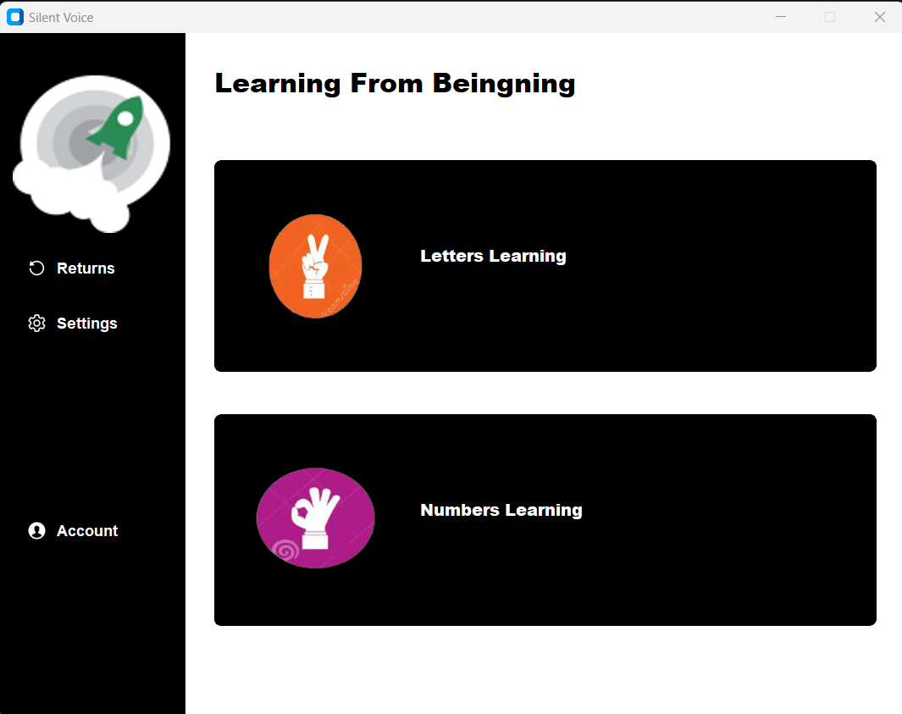
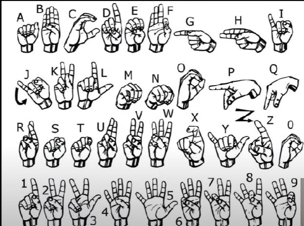
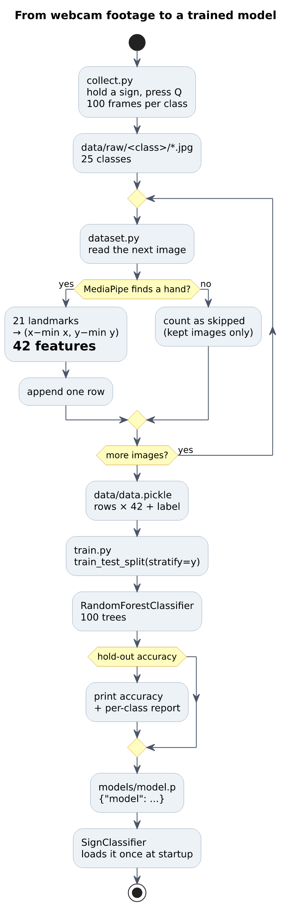
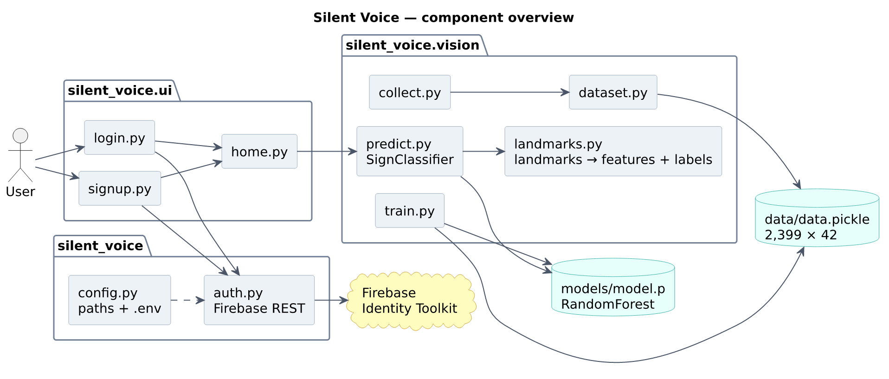
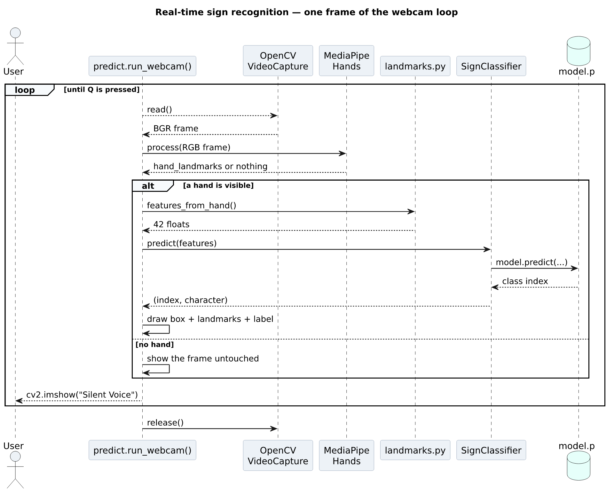
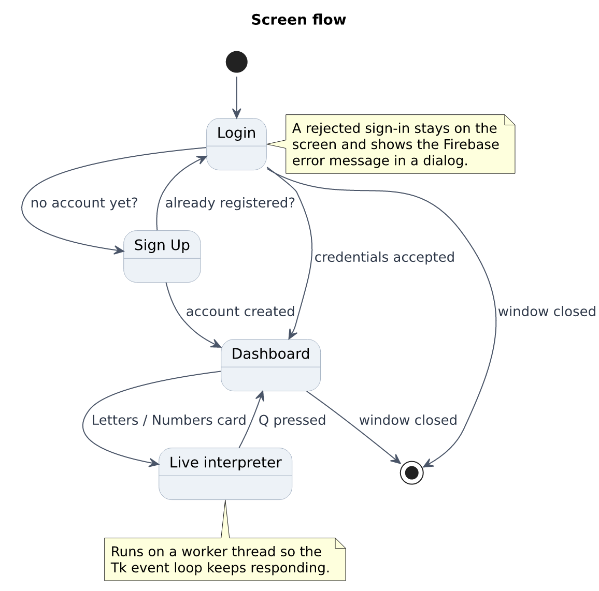

# Silent Voice

A desktop app that reads the American Sign Language alphabet off your webcam and puts the letter on screen. You sign, it names the letter, the frame keeps running. There's a login screen in front of it and a small dashboard behind it, mostly because the project started life as a normal CRUD-style coursework app and I never bothered to rip those out.

It recognises 25 signs: the letters A through Y, with a handful of honest caveats listed further down.



---

## What it actually does

Open the app, sign in, pick a card on the dashboard, and the OpenCV window takes over. MediaPipe finds your hand, the 21 landmarks get squashed into a 42-number vector, and a random forest throws back a class index that maps to a letter. The prediction and the bounding box are drawn on top of the video.

Three things I care about more than the demo effect:

- **It runs locally.** Nothing is uploaded. The only network call in the whole app is the Firebase sign-in.
- **The camera is released properly.** The old version left `cv2.VideoCapture` open on an exception, so the second run of the app would fail to find a camera until you restarted the process. It lives in a `try/finally` now.
- **No invented confidence score.** A random forest gives you a class, not a percentage you can trust. Rather than decorating the video with a number pulled out of thin air, the app shows the letter, and the limitations section below says plainly which signs are shaky.

## The signs it knows



Letter to class index is a plain dict in `silent_voice/vision/landmarks.py`. If your dataset used a different folder order, that's the only file you need to touch.

| | | | | |
|---|---|---|---|---|
| A | B | C | D | E |
| F | G | H | I | J |
| K | L | M | N | O |
| P | Q | R | S | T |
| U | V | W | X | Y |

`Z` was never recorded, and `J` normally involves motion that a single frame can't show. Both are called out below.

## Getting it running

You need Python 3.10 to 3.12 and a webcam. MediaPipe 0.10.x ships wheels for exactly those versions, which is why `requirements.txt` pins the range it does.

```bash
git clone https://github.com/ansarikaif28/sign-language_interpretor.git
cd sign-language_interpretor

python -m venv .venv
source .venv/bin/activate        # Windows: .venv\Scripts\activate
pip install -r requirements.txt
```

Then set up the Firebase bits:

```bash
cp .env.example .env
```

Open `.env` and paste in the API key and project details from your Firebase console (Project settings → Your apps → Web app).

There are two ways to start it. The full app goes through the login screen:

```bash
python run.py                    # or: python -m silent_voice
```

If you just want to see the recognition running, skip the UI entirely:

```bash
python -m silent_voice.vision.predict
```

That second command only needs `models/model.p`, which is already in the repo, so it works on a fresh clone with no Firebase setup at all. Handy when you're working on the ML side and don't want to log in forty times an hour.

On Linux you may need `sudo apt install python3-tk libgl1` first. `libgl1` catches people out because MediaPipe pulls in a GUI build of OpenCV.

### About the camera index

Default is `1`, which is what the machine this was built on used. Plenty of laptops want `0`. Change `CAMERA_INDEX` in `.env` or pass `--camera 0`. If the app can't open a camera you get a message telling you that, instead of a traceback.

## Training your own model

The shipped classifier is trained on 2,399 hand crops recorded with the same pipeline. If you want your own signs, or your own hand, the three steps are:

```bash
# 1. record 100 frames per class (hold the sign, press Q, repeat)
python -m silent_voice.vision.collect --classes 25 --per-class 100

# 2. turn the images into a feature table
python -m silent_voice.vision.dataset --data-dir data/raw

# 3. train and save
python -m silent_voice.vision.train --data data/data.pickle --model models/model.p
```



Two things about `dataset.py` are worth knowing. It uses **only the first detected hand** in each image, the same as inference, so the two can never disagree about which hand they're looking at. And it reports how many images it skipped because MediaPipe found no hand, so a badly lit session shows up as a number instead of as a mysteriously small dataset. The original script dropped those frames silently, which is how you lose an afternoon wondering why 2,500 photos became 900 rows.

## How it's put together



| Path | What's in it |
|---|---|
| `silent_voice/config.py` | Paths and `.env` loading, resolved from the repo root |
| `silent_voice/auth.py` | Firebase email/password over the Identity Toolkit REST API |
| `silent_voice/ui/auth_screen.py` | The pieces login and sign-up share |
| `silent_voice/ui/login.py` | Login screen |
| `silent_voice/ui/signup.py` | Sign-up screen |
| `silent_voice/ui/home.py` | Dashboard; starts the webcam on a worker thread |
| `silent_voice/vision/landmarks.py` | Feature vector, label map, bounding box |
| `silent_voice/vision/predict.py` | `SignClassifier` and the webcam loop |
| `silent_voice/vision/collect.py` | Record a dataset from the camera |
| `silent_voice/vision/dataset.py` | Images in, `data/data.pickle` out |
| `silent_voice/vision/train.py` | Train and save `models/model.p` |
| `silent_voice/assets/` | Icons and background used by the UI |

### The feature vector

For each of MediaPipe's 21 hand landmarks, the vector stores `x - min(x)` and `y - min(y)`. That's 42 numbers. Subtracting the minimum makes the vector independent of where the hand sits in the frame, which is why you don't have to centre yourself. It is *not* independent of rotation or distance from the camera, so framing matters more than you'd think — sit roughly where you sat when you recorded the data.

Training uses exactly the same function as inference (`features_from_hand`), which is the whole point of having `landmarks.py` instead of two copies of the same six lines. If those drift apart, the model happily accepts the wrong numbers and predicts nonsense with no error anywhere.

### One frame through the loop



### Screens



The dashboard went through a couple of layouts before it settled. The two earlier attempts are still in `docs/screenshots` for anyone who's curious — [one with a metrics strip](docs/screenshots/home-metrics-layout.png) borrowed wholesale from a logistics template, and [one with stacked cards](docs/screenshots/home-card-layout.png) that was closer but cramped.

## Model performance

I re-ran the training script against the committed dataset so the numbers below come from the data in the repo rather than from memory:

| Metric | Value |
|---|---|
| Samples | 2,399 |
| Feature vector | 42 floats |
| Classes | 25 |
| Samples per class | 44 (min) to 100 (max) |
| Hold-out accuracy (80/20, stratified, seed 42) | 100.00% |
| 5-fold cross-validation | **98.79% ± 1.48** |

**Neither number means the app is right 99% of the time.** Every sample came from a small number of recording sessions, so the same hand, the same lighting and the same camera show up in both halves of the split. The five-fold figure is the one to quote: it re-uses every sample as test data once, so it is far less flattering than a single lucky split. What these results really establish is that the 25 classes are separable when the framing matches the training session. Point a different camera at a different person in a different room and expect real mistakes.

If you want an honest generalisation number for your own setup, record one session in a different room and test on that, not on a random slice of the session you trained with.

Reproduce it with:

```bash
python -m silent_voice.vision.train --data data/data.pickle --model models/model.p --seed 42
```

## Things it doesn't do

Worth knowing before you show this to anyone:

- **Z isn't in the model.** No class was recorded for it.
- **J is a motion sign.** The dataset holds one static frame of it, so the prediction follows the hand shape but not the movement.
- **Static frames only.** This is alphabet recognition, not continuous sign language translation. There are no words, grammar or sentence structure here.
- **Lighting and distance matter.** The 42-feature vector normalises position, not scale or orientation.
- **One hand only.** Inference takes the first hand MediaPipe reports.
- **The login is a speed bump, not security.** It creates and authenticates real Firebase accounts, but it only gates the UI; nothing else in the app is protected by it.
- **The `Returns` and `Settings` sidebar buttons are decorative.** They came with the dashboard template and nothing is wired to them.

## Things I fixed on the way through

If you're comparing this against an older copy, these were the changes that mattered:

| Was | Now |
|---|---|
| Model path hardcoded as `D:/Finals Project/...` | `models/model.p`, resolved from the repo root |
| Asset paths as `images\\background1.png` (Windows-only) | `config.asset(...)`, works everywhere |
| `except:` that re-created the classifier forever on any error | Errors raised or shown in a dialog |
| Camera index by memory, no error if absent | `CAMERA_INDEX` in `.env`, clear error message |
| Firebase API key committed in two files | Read from `.env`, `.env` git-ignored |
| `firebase_admin.auth.sign_in_with_email_and_password(...)`, which doesn't exist | Identity Toolkit REST, which does |
| Label map with 26 entries and one digit | 25 letters, matching the actual model |
| `scikit-learn=` (typo) in `requirements.txt` | Pinned, installable requirements |
| Three near-identical Tk screens | Shared `auth_screen.py` |

## Requirements

Python 3.10 – 3.12, plus the packages in `requirements.txt`: OpenCV, MediaPipe, scikit-learn, NumPy, Pillow, customtkinter, python-dotenv, requests. Firebase credentials are only needed for the login screen.

## Licence

MIT — see [LICENSE](LICENSE).

The hand-shape reference chart (`docs/asl-sign-chart.png`) comes from the ASL alphabet charts in common circulation and is included for reference only.
